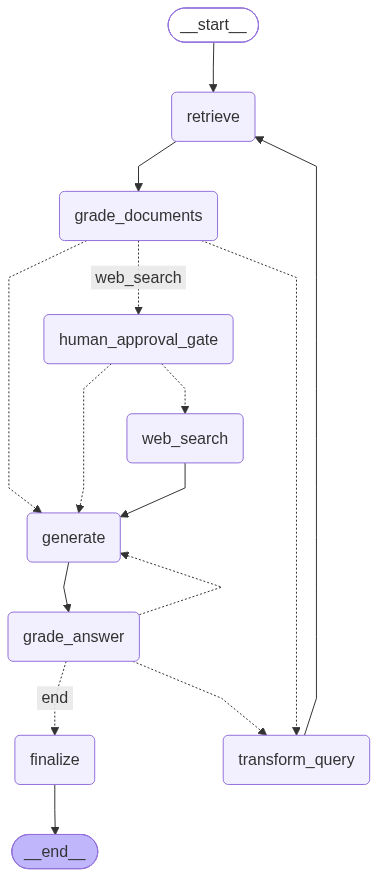

# Agentic RAG over Documents

A self-correcting **agentic RAG** system over a corpus of 8 foundational LLM/RAG
papers, built on **LangGraph**. It retrieves with hybrid search (dense + BM25,
fused with Reciprocal Rank Fusion), grades its own retrieval (**CRAG**) and its
own answers (**Self-RAG**), answers with inline source citations, remembers
multi-turn conversations, and asks a human before it searches the web. It runs as
a FastAPI service in Docker, is deployed on Render and AWS, and is traced
per node in LangSmith with cost guardrails on every request.

**Live demo:** <https://agentic-rag-over-documents.onrender.com/docs>

`/ask` and `/resume` need an `X-API-Key` header; email me at
roshansinghsaud2001@gmail.com for a key. `/health` and `/ready` are open.
Free hosting: the first request after 15 idle minutes can take about a minute
while the container wakes.

## Results at a glance

| What | Result | Evidence |
| --- | --- | --- |
| Eval caught a silent data bug | 2,872 chunks indexed instead of 718; fixing it raised context recall **0.77 → 0.86** and faithfulness **0.94 → 0.97** | [Evaluation](#evaluation) |
| Cold start on AWS | prebuilt vector index restored from S3: index step **48.3 s → 0.8 s** | [Deployment](#deployment) |
| Where the money goes | per-node tracing showed per-chunk document grading is **69%** of inference cost, not answer generation | [Observability and cost](#observability-and-cost) |
| Cost levers, measured | batched grading **−26%**, + model routing **−31%** cost per question, but faithfulness **0.98 → 0.92**, so both ship behind flags, off by default | [Observability and cost](#observability-and-cost) |

## Build status

The build is layered: each layer adds one capability and ends in a git tag.

| Layer | Tag | Status |
| --- | --- | --- |
| 1 — Baseline RAG (hybrid retrieve → generate with citations) | `v0.1-baseline` | **done** |
| 2 — CRAG (grade docs, conditional routing, transform_query, web_search) | `v0.2-crag` | **done — verified live** |
| 3 — Self-RAG (grade answer, regenerate / re-retrieve) | `v0.3-self-rag` | **done — verified live** |
| 4 — Memory + HITL (checkpointer + one interrupt gate) | `v0.4-memory-hitl` | **done — verified live** |
| 5 — Eval (RAGAS + golden set, caught a real data bug) | `v0.5-eval` | **done** |
| 6 — API (FastAPI `/ask` + `/resume` + `/health`, 409 guards) | `v0.6-api` | **done** |
| 7 — Docker (Dockerfile + compose) | `v0.7-docker` | **done — verified live** |
| 8 — Deploy + ops (config, API hardening, Render, AWS, tracing, cost guardrails) | — | **in progress** on branch `layer8-deploy` |

What Layer 8 has shipped so far:

| Step | What shipped |
| --- | --- |
| Image | pinned lockfile, eval dependencies split into `requirements-dev.txt`, multi-stage build ([sizes](#image-size)) |
| Config | every setting from environment variables via Pydantic Settings; missing keys stop the process at startup; binds to `$PORT` |
| Index bootstrap | the FastAPI lifespan builds or restores the index before serving; `/ready` returns 503 until it has documents |
| Front door | `X-API-Key` auth (constant-time compare), 10 requests/min per IP, one worker |
| Render | public demo, papers baked into the image so a cold start never depends on arXiv |
| Tests | `pytest` suite, 25 tests, no network or API key needed |
| AWS | image in ECR, running on EC2 under an IAM role (no keys on the box), CloudWatch logs with an error alarm to email, index restored from S3 |
| Tracing | LangSmith, per node: tokens, latency, cost |
| Cost guardrails | global step budget, per-session token ceiling, one JSON cost line per request; batched grading and model routing behind flags |

Day-by-day notes, including what broke and how it was diagnosed from logs:
[`docs/deploy-notes.md`](docs/deploy-notes.md). Verification traces and
screenshots for each layer: [`output documentation/`](<output documentation/>).

## Architecture



Two self-correction loops, one on each side of generation:

**CRAG — grade the retrieval (input side).** Every retrieved chunk is graded for
relevance by a structured-output LLM grader; only relevant chunks survive. If too
few survive, the graph rewrites the query and re-retrieves (capped at
`MAX_RETRIEVAL_LOOPS`), then falls back to a Tavily web search as a last resort.
Web-sourced chunks are tagged `[web]`.

**Self-RAG — grade the answer (output side).** No answer leaves the graph
unchecked. A grounding grader checks the answer against the retrieved chunks; an
answer grader then checks it addresses the question. Each failure routes to the
stage that caused it: not grounded → regenerate (capped at
`MAX_GENERATION_LOOPS`); grounded but off-topic → rewrite the query and
re-retrieve (shared rewrite budget). An honest "I don't know" is accepted, not
looped on. When a budget runs out, the best-effort answer is returned and labeled
as such.

**Memory — checkpointed, multi-turn threads.** The graph compiles with a SQLite
checkpointer, so each `thread_id` is a persistent conversation that survives a
process restart. The answer is appended to the history inside the graph (a
terminal `finalize` node), so the memory write shares the turn's checkpoint.
Correction budgets reset every turn.

**HITL — one approval gate, on the highest-stakes action.** The only point where
the graph leaves the document corpus is the web-search fallback, so that edge
gets a human gate: the graph pauses with LangGraph's `interrupt()` and the API
returns `needs_approval`; `POST /resume` approves or denies. Denial falls back to
a best-effort answer from what survived grading, which the generator's
abstention rule keeps honest. Unrecognized input counts as denied.

**Step budget — the limit above both loops.** The graph's recursion limit is set
to `MAX_GRAPH_STEPS` (20); LangGraph exposes what's left as
`state["remaining_steps"]`. The routers only take a loop if every node up to the
end still fits, and otherwise finish with a best-effort answer. The longest
normal path is 17 nodes, so this never cuts a normal run; it turns a runaway loop
into an answer instead of an HTTP 500.

Regenerate the diagram with `python view_graph.py`.

## Evaluation

One harness (`eval/run_eval.py`), one hand-written golden set
(`eval/golden_set.json`): 20 questions in five categories (`lookup`,
`multi_hop`, `no_answer`, `needs_web`, `known_failure`), each built to force one
branch of the graph. Scoring has two layers: **deterministic behaviour checks**
(did it abstain, reach the approval gate, retrieve the expected papers?) and
**RAGAS** (answer correctness, faithfulness, context precision and recall). The
approval gate is auto-declined during eval; `--approve-web` flips it. Each
question's LLM calls, tokens and cost are recorded too. How-to:
[`eval/README.md`](eval/README.md); the story of the first runs:
[`output documentation/layer5_eval_explained.md`](<output documentation/layer5_eval_explained.md>).

**The eval caught a silent data bug on its first run.** Multi-hop questions
scored 1/4 with suspiciously thin context. Tracing showed `hybrid_retrieve`
returning about 2 chunks instead of `TOP_K=6`; the Chroma index held 2,872
chunks, exactly **4 × 718**, because `ingest` had been run four times and
`Chroma.from_documents` appends. RRF's de-duplication then collapsed the
duplicate-heavy candidate lists. Fix: `ingest` made idempotent, index rebuilt.

| run | behaviour pass | context recall | context precision | faithfulness | answer correctness |
| --- | --- | --- | --- | --- | --- |
| `v0.4` (duplicated index) | 15/20 | 0.765 | 0.697 | 0.941 | 0.657 |
| `v0.4-fixed` (clean index) | 15/20 | **0.856** | **0.759** | **0.972** | 0.633 |

The retrieval metrics moved where a retrieval bug should move them (multi-hop
context recall 0.556 → 0.722); LLM-judged correctness shifts under 0.1 are judge
noise. Behaviour pass didn't move: the same five questions fail in both runs,
which separates two **prompt-level** problems from the data bug. (1)
*Comparative questions*: the grader rejects single-paper chunks as irrelevant to a
two-paper comparison ("How does CRAG differ from HyDE?" rejected 18/18 chunks
across three attempts). (2) *Definitional over-abstention*: "How does HyDE
retrieve documents…" answered "I don't know" while holding 6/6 relevant chunks.
Both are still open.

```bash
python -m eval.run_eval --label mytest --skip-ragas   # fast, behaviour checks only
python -m eval.run_eval --label mytest                # full run incl. RAGAS
pytest                                                # unit + API tests, no network
```

## Deployment

### Render (live demo)

The image builds from the `Dockerfile` with the papers baked in; on first boot
the FastAPI lifespan builds the index before the server accepts requests, and the
image's health check polls `/ready`.

### AWS

The same image, built for `linux/amd64`, pushed to **ECR** and run on **EC2**:

- **IAM:** the instance role can pull from ECR, write to one log group and read
  the index objects in one S3 bucket. No access keys on the box.
- **CloudWatch:** the container's `awslogs` log driver ships stdout to the
  `/rag/app` log group. A metric filter on `ERROR` feeds an alarm that emails
  through **SNS**; tested by starting the container with a bad OpenAI key.
- **S3 index store:** on a cold boot the app downloads a prebuilt Chroma index
  from S3 (`INDEX_S3_URI`) instead of re-embedding the corpus: **48.3 s → 0.8 s**
  for the index step, no OpenAI calls at boot, and every box serves an identical
  index.

A full agent run in CloudWatch Logs Insights: the human approves the web search,
Tavily runs, and `/resume` returns 200
([earlier part of the same run](<output documentation/cloud/cloud watchlogs_1.png>)):


### Image size

| build | disk | compressed |
| --- | --- | --- |
| baseline | 960MB | 199MB |
| unused `langchain` dropped | 958MB | 199MB |
| multi-stage + pinned lockfile | 963MB | 199MB |

Multi-stage made the image 3MB **larger** (the copied venv carries its own pip
and setuptools); compressed size, which is what registry push and pull pay for,
never moved. The real reduction came earlier, from moving the eval dependencies
(`ragas`, `datasets`, `pandas`, `pyarrow`) into `requirements-dev.txt`. What
remains is chromadb's ONNX and gRPC stack. Multi-stage stays for the
pinned-lockfile install, not for size.

## Observability and cost

### Where the cost is (LangSmith)

Tracing needs no code: with `LANGSMITH_TRACING=true`, every graph run is traced,
each node is a child run, and every LLM call inside a node carries
`metadata.langgraph_node`, so cost can be grouped by node.
`scripts/cost_by_node.py` pulls one eval run's traces back and builds the table.

Golden set, 20 questions, cost per question by node:

| node | LLM calls | tokens in | $ / question | share |
| --- | ---: | ---: | ---: | ---: |
| `grade_documents` | 10.8 | 4,542 | $0.000720 | **69%** |
| `generate` | 1.0 | 904 | $0.000168 | 16% |
| `grade_answer` | 1.1 | 912 | $0.000136 | 13% |
| `transform_query` | 0.8 | 84 | $0.000021 | 2% |

About $0.00105 per question (≈ $1.05 per 1,000). The grader makes one call per
retrieved chunk (6 a round), each repeating the same instructions, and every
query rewrite runs another round, so a question the corpus can't answer makes 18
grading calls to reach "I don't know".


### Cost levers, measured

Same 20 questions, list-price cost from a callback that counts every LLM call
(`src/cost.py`), quality from RAGAS:

| config | $ / question | change | LLM calls | behaviour | faithfulness | answer correctness |
| --- | ---: | ---: | ---: | ---: | ---: | ---: |
| default | $0.001055 | — | 13.7 | 15/20 | **0.98** | 0.68 |
| model routing only | $0.001025 | −3% | 14.0 | 14/20 | — | — |
| batched grading | $0.000778 | −26% | 4.1 | 14/20 | 0.92 | 0.66 |
| batched + routing | $0.000724 | **−31%** | 4.2 | 15/20 | 0.92 | 0.74 |

- **Batched grading** (`GRADE_BATCH`) grades all chunks of a round in one call.
  It's where the saving is, but graded together the model is more lenient: fewer
  questions reach the rewrite loop or the web-search gate, and faithfulness drops.
- **Model routing** (`MODEL_ROUTING`) sends simple questions' answers to
  `gpt-5-nano`, using a rule-based classifier (`src/routing.py`). Alone it saved
  3%, and twice the small model answered from its own knowledge when it had no
  documents. The graders were never routed: replaying 60 real grading calls,
  `gpt-4.1-nano` rejected 16 and `gpt-5-nano` 7 of the 30 chunks `gpt-4o-mini`
  kept.
- **Decision:** both off by default. At about $1 per 1,000 questions, grounding
  is worth more than 26–31%. Each is one environment variable.

Full write-up: [`docs/deploy-notes.md`](docs/deploy-notes.md) (Day 21);
per-config results in `eval/results/summary_day21-*.md`.

### Guardrails (always on)

- **Step budget**: `MAX_GRAPH_STEPS=20` (see [Architecture](#architecture)).
- **Per-session token ceiling**: `SESSION_TOKEN_LIMIT=100000` per `thread_id`,
  tracked in a `session_usage` table in the checkpoint SQLite file. Past it,
  `/ask` returns 429; `/resume` still lets a paused turn finish.
- **Cost log**: one JSON line per request on stdout, which CloudWatch Logs
  Insights can query field by field:

  ```json
  {"event": "request_cost", "endpoint": "/ask", "status": "completed", "route": "complex", "llm_calls": 9, "input_tokens": 6049, "output_tokens": 172, "cached_input_tokens": 2944, "cost_usd": 0.00101, "latency_ms": 6500, "session_tokens": 6221}
  ```

## Quickstart

### Docker

```bash
# 1. Keys: OPENAI_API_KEY and API_KEY are required; TAVILY_API_KEY enables the web fallback
cp .env.example .env

# 2. On a fresh clone only: these must exist as files before the first run,
#    or Docker bind-mounts a directory in their place (breaks SQLite)
touch checkpoint.db checkpoint.db-wal checkpoint.db-shm

# 3. Build and start; the first boot builds the index (under a minute) before serving
docker-compose up --build -d
curl localhost:8000/ready
```

Swagger UI is at `http://localhost:8000/docs`. Ask a question:

```bash
curl -X POST localhost:8000/ask \
  -H "X-API-Key: <your API_KEY>" -H "Content-Type: application/json" \
  -d '{"thread_id": "demo", "question": "What are reflection tokens in Self-RAG?"}'
```

If the graph wants to search the web it returns `"status": "needs_approval"`;
answer with `POST /resume` and `{"thread_id": "demo", "approved": true}`.

### Local (interactive CLI)

```bash
python -m venv agentic-rag && source agentic-rag/bin/activate
pip install -r requirements.txt
cp .env.example .env

python main.py ingest       # downloads the papers if data/ is empty, builds the index
python main.py ask demo     # interactive; the same thread id resumes later
uvicorn app:app --reload    # ...or serve the API locally
```

The trace lines show the graph deciding (`--- GRADE: 4/6 chunks relevant ---`,
`--- TRANSFORM (loop 1): ... ---`, `[APPROVAL NEEDED]`), and every answer ends
with a `SELF-CHECK` verdict and a `COST` line.

All settings, with defaults and what they do, are in
[`.env.example`](.env.example).

### Corpus

The 8 papers (listed in [`data/README.md`](data/README.md)) aren't committed to
git. The Docker build downloads them from arXiv by paper ID
(`scripts/fetch_corpus.py`); locally, `ingest` does the same when `data/` is
empty. Put your own files in `data/` first to use a different corpus.

## Layout

```
src/
  config.py      # every setting, from environment variables (Pydantic Settings)
  state.py       # the shared GraphState TypedDict
  corpus.py      # fetch the papers from arXiv (stdlib only, runs at image build)
  ingestion.py   # load + chunk + persist Chroma; ensure_index(): S3 restore or build
  retrieval.py   # dense + BM25 + RRF fusion
  nodes.py       # retrieve, generate, CRAG + Self-RAG graders, HITL gate, routers, step budget
  graph.py       # the LangGraph StateGraph wiring
  cost.py        # CostTracker callback + JSON cost log
  budget.py      # per-session token ledger (SQLite)
  routing.py     # simple/complex question classifier for model routing
app.py           # FastAPI: /ask, /resume, /health, /ready; API key, rate limit, cost guardrails
main.py          # CLI: ingest / ask
Dockerfile       # multi-stage, python:3.12-slim, papers baked in, HEALTHCHECK on /ready
docker-compose.yml
scripts/         # fetch_corpus.py, cost_by_node.py, startup checks
tests/           # pytest suite
eval/            # golden set, harness, results
docs/deploy-notes.md     # Layer 8 day-by-day: goal, what broke, diagnosis, fix
output documentation/    # per-layer verification traces and screenshots
view_graph.py    # render graph.png
```

## Stack

LangGraph · LangChain · OpenAI (`gpt-4o-mini`, `text-embedding-3-small`) ·
ChromaDB · BM25 (`rank_bm25`) · Tavily · FastAPI · Docker · SQLite · RAGAS ·
LangSmith · pytest · Render · AWS (ECR, EC2, S3, CloudWatch, SNS)

## Known limitations

- **Conversation memory is a SQLite file on the container's disk.** It doesn't
  survive a redeploy on Render, and it's safe for one process only (hence
  `--workers 1`). Scaling out would need a server-backed checkpointer.
- **Citations aren't verified one by one.** The answer as a whole is graded for
  grounding, and the eval checks the expected papers were retrieved; nothing
  checks that each `[n]` supports its own sentence.
- **No reranker, and chunk size (1000/150) is the default**, not a tuned value.
- **Two prompt-level failures are open** (comparative questions, definitional
  over-abstention); behaviour pass is 15/20.
- **The golden set is 20 questions.** A one-question difference between runs is
  noise.
- **The session ceiling is checked before each request**, so the request that
  crosses it still completes; and `thread_id` is chosen by the client, so it
  limits a conversation, not a person (the per-IP rate limit does that).
- **Costs are at list price.** LangSmith shows lower numbers when OpenAI's prompt
  cache applies, which re-running identical eval prompts triggers.
- **The AWS deployment isn't kept running**; the live demo is Render.
